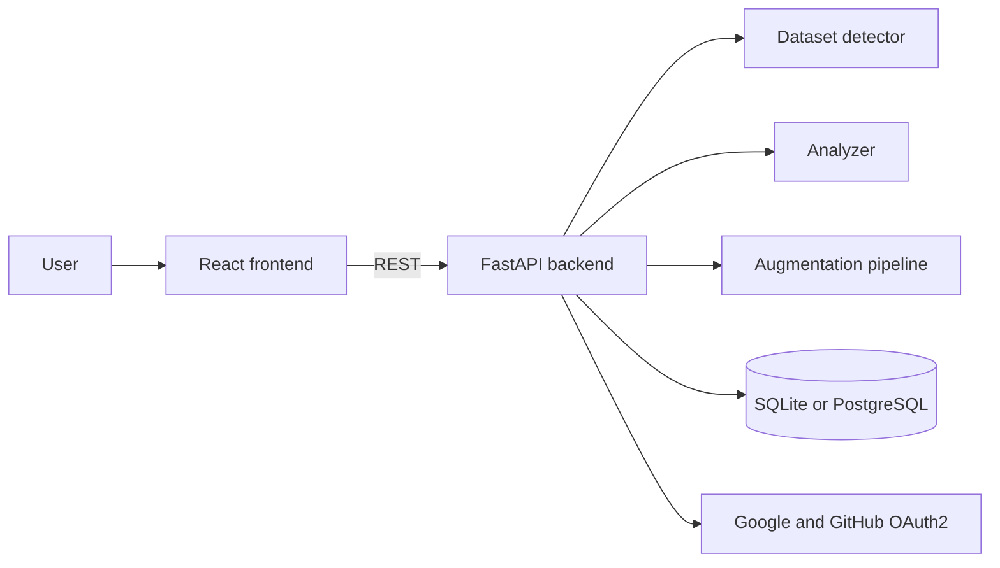

# DataVal.ai

[](https://www.python.org/)
[](https://fastapi.tiangolo.com/)
[](https://react.dev/)
[](https://vite.dev/)
[](https://www.docker.com/)

**DataVal.ai** is an AI dataset analytics, validation and augmentation platform. Upload a dataset as a ZIP archive, and it detects the dataset type, reports quality problems such as data leakage and class imbalance, fixes or augments the data, and lets you download the result.

## Key features

- **Automatic dataset detection:** recognizes classification, segmentation and tabular datasets from the archive structure.
- **Quality analysis:** checks for data leakage, missing values, duplicates, unreadable images and class distribution.
- **Fast image augmentation:** uses OpenCV lookup tables (`cv2.LUT`) on a `ThreadPoolExecutor`, since OpenCV releases the GIL during processing.
- **Safe background tasks:** per-task locks prevent cleanup from racing with an export in progress.
- **Streaming export:** the processed dataset is streamed to the client as a ZIP file.
- **Authentication:** email and password sign-in with JWT Bearer tokens, plus Google and GitHub OAuth2.
- **Reports and history:** diagnostic charts, PDF reports and a history of past analyses.

## Architecture



### Frontend

| Area | Technology |
| --- | --- |
| Framework | React 19, Vite 7 |
| Styling | Tailwind CSS v4, Lucide icons |
| Animation | Framer Motion |
| Charts and reports | Recharts, html2canvas, jsPDF, React-PDF |
| State and routing | Context API, React Router v7, Axios |

### Backend

| Area | Technology |
| --- | --- |
| Framework | FastAPI, Uvicorn, Pydantic |
| Data and vision | Pandas, Polars, scikit-learn, NumPy, OpenCV, Pillow |
| Concurrency | `ThreadPoolExecutor`, per-task locks |
| Database | SQLAlchemy, SQLite for development, PostgreSQL for production |
| Security | python-jose, Passlib, bcrypt, OAuth2 over HTTPX |

## Getting started

### Requirements

- [Node.js](https://nodejs.org/) 20.19 or newer
- [Python](https://www.python.org/) 3.9 or newer
- Access to this repository (the default branch is `dataval-v1`)

### 1. Backend

```bash
cd dataval_backend
pip install -r requirements.txt
pip install opencv-python-headless
cp .env.example .env
uvicorn main:app --reload --port 8000
```

Fill in `.env` before starting. If `DATABASE_URL` is empty, the app falls back to a local SQLite database. Interactive API documentation is available at http://localhost:8000/docs.

### 2. Frontend

```bash
cd dataval_frontend
npm install
npm run dev
```

The client runs at http://localhost:5173.

### 3. Docker

Create `dataval_backend/.env` first, then build and run from source:

```bash
docker compose up --build -d
```

To run the published `dreemurr52/dataval-*` images instead:

```bash
docker compose -f docker-compose.prod.yml up -d
```

In both cases, the frontend is served on port 80 and the backend on port 8000.

## Main API endpoints

| Method | Endpoint | Description |
| --- | --- | --- |
| `POST` | `/stage` | Upload a dataset and create a task |
| `POST` | `/analyze/{task_id}` | Start the analysis |
| `GET` | `/status/{task_id}` | Read task status and results |
| `POST` | `/abort/{task_id}` | Cancel a running task |
| `POST` | `/fix/{task_id}` | Apply automatic fixes |
| `POST` | `/augment-apply/{task_id}` | Apply augmentations |
| `GET` | `/api/export/{task_id}` | Download the processed dataset |
| `GET` | `/history` | List past analyses |
| `POST` | `/api/auth/register`, `/api/auth/login` | Create an account or sign in |

## Project structure

```text
.
├── dataval_backend/
│   ├── main.py              # API server and processing pipelines
│   ├── analyzer.py          # Validation and leakage analysis
│   ├── detector.py          # Dataset type detection
│   ├── auth.py, oauth.py    # Authentication
│   ├── config.py            # Settings
│   ├── database.py, models.py
│   └── requirements.txt
├── dataval_frontend/
│   ├── src/pages/           # Application pages
│   ├── src/views/           # Upload, processing and results views
│   └── src/components/      # Shared components
├── docker-compose.yml       # Build and run from source
└── docker-compose.prod.yml  # Run published images
```

## License

[MIT](LICENSE)
